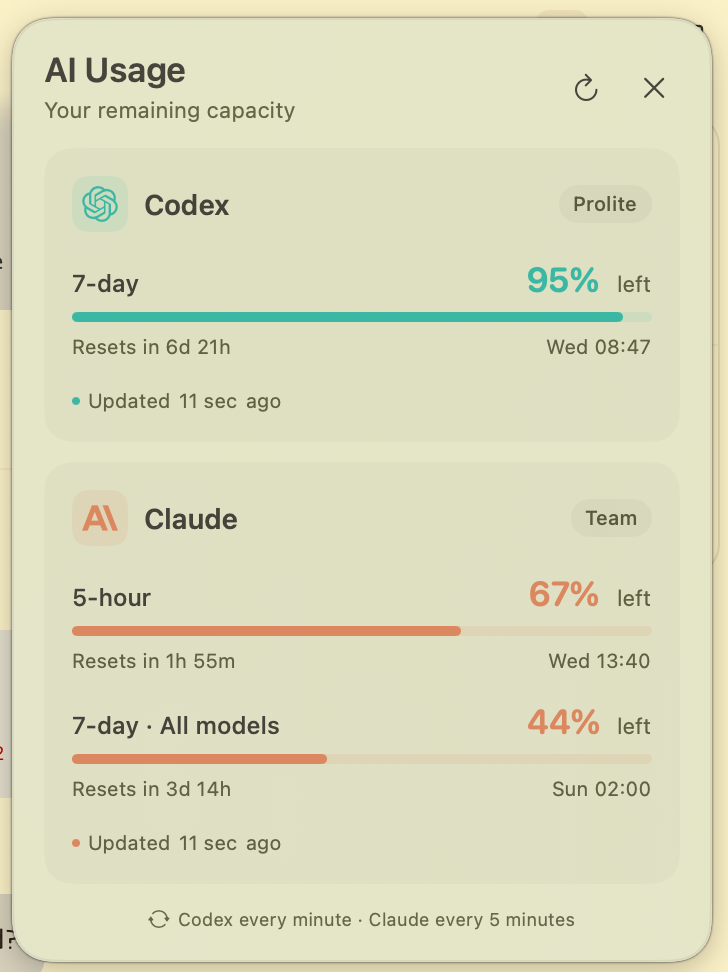
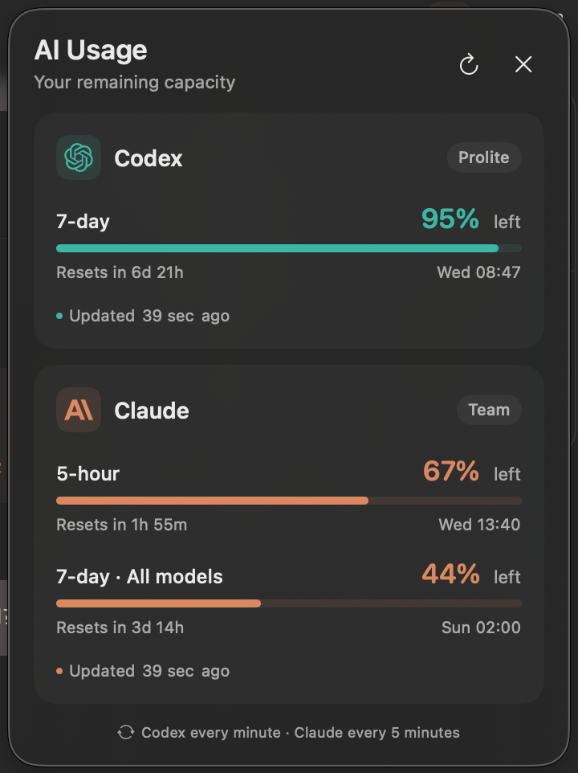

# Usage Notifier

<p align="center">
  
  
</p>

A small native macOS floating card showing your **remaining Codex and Claude capacity**, with reset countdowns and local reset times. Inspired by `caffeinate-gui`, with the usage integrations adapted from `ai-usage`.

## Build and run

Requires macOS 13+, Apple Command Line Tools, and Go 1.24+ to build. Log in with the Codex and Claude CLIs first.

```sh
./scripts/build.sh
open "build/Usage Notifier.app"
```

You can move the built app into Applications. Go is bundled as a compiled helper and is not required to run it. The installed Codex CLI is required at runtime; Claude credentials come from your existing Claude Code login.

## Behavior

- Floats at the top right across Spaces, like Caffeinate. Drag its background to reposition it.
- Shows only the limits actually returned by each provider. A missing 5-hour or weekly window is not assumed to be unlimited.
- Bars show **remaining** capacity. Orange means 25% or less remains; red means 10% or less remains.
- Refreshes Codex every minute and Claude every five minutes. Refresh button / Command-R rechecks eligible providers without bypassing cooldowns.
- Keeps the last successful reading on failures, labels the error and last successful update, and shows the retry countdown.
- Honors Claude's `Retry-After` response (15-minute fallback). Backoff and usage cache are held in memory for the app's lifetime.
- Close button / Command-Q quits. Pressing Q while the app is focused also quits. No notification permissions required.

## Data sources

Codex uses the local CLI's [`account/rateLimits/read` app-server method](https://learn.chatgpt.com/docs/app-server). The CLI owns authentication. The app reads subscription usage, not API billing or local token estimates.

Claude uses `https://api.anthropic.com/api/oauth/usage` with Claude Code's OAuth credentials from the macOS Keychain (`Claude Code-credentials`), falling back to `$CLAUDE_CONFIG_DIR/.credentials.json` or `~/.claude/.credentials.json`. Supports the legacy window response and newer scoped model limits used by `ai-usage`. This endpoint may change independently of the app.

Tokens stay in the helper's memory and are sent only to Anthropic's usage endpoint. They are never included in app output or saved by Usage Notifier. A Keychain permission prompt may appear on first access.

Finder's minimal PATH is supplemented with Homebrew, `~/.local/bin`, and common Nix locations to find Codex.

## Verify

```sh
(cd helper && go test -race ./... && go vet ./...)
```

For a live diagnostic, the bundled helper prints usage-only JSON (no tokens):

```sh
"build/Usage Notifier.app/Contents/MacOS/usage-helper" --once
```
